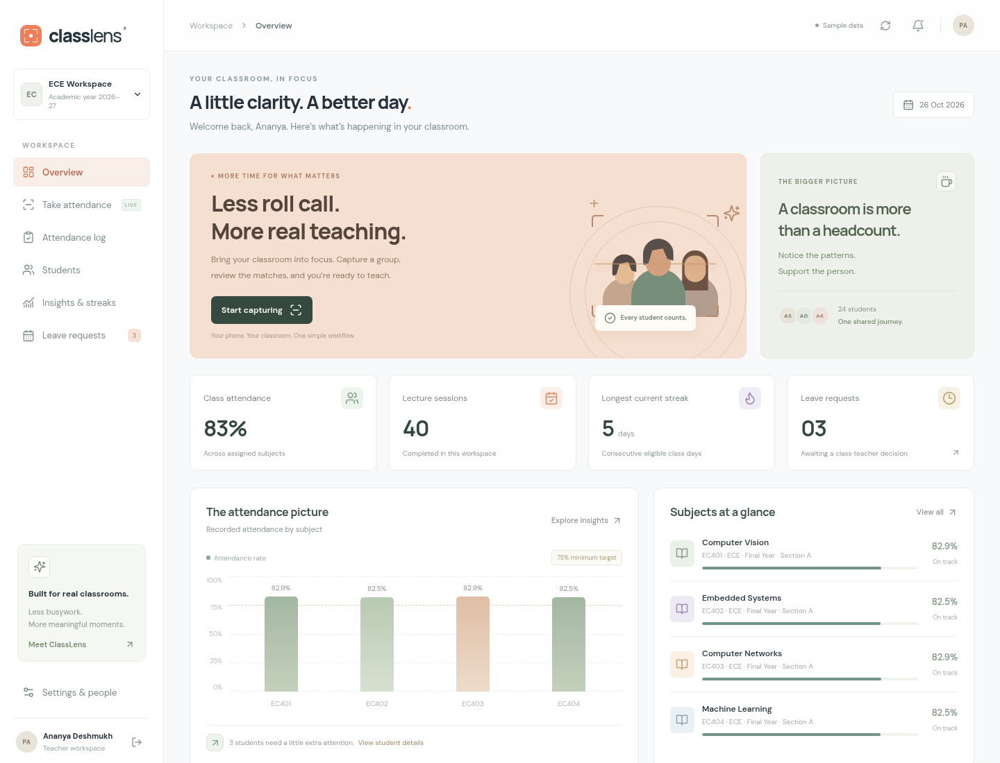

<div align="center">

# ClassLens

### A clearer picture of classroom attendance.

Mobile camera attendance · Teacher review · Student insights · Leave management

**Made by Harshad Madhav Dhuppe**<br/>
**Electronics & Computer Engineering · Batch of 2027**

[](#technology)
[](#technology)
[](LICENSE)

</div>

---



ClassLens is a final year engineering project for managing attendance around the way a classroom actually works. Teachers use a phone or laptop to start a subject session, capture visible students, review uncertain results, and correct records. Students can understand their attendance and submit leave requests; administrators control teaching assignments.

The project combines a carefully designed interface with a persistent Python backend. Attendance is stored per lecture, corrections are traceable, and recognition is treated as a decision that needs validation—not an infallible identity check.

> **Development application:** Included accounts and academic records are fictional demonstration data. Face recognition requires the model files and enrolled, consented face samples. No measured recognition accuracy is claimed.

## The classroom workflow

1. A teacher signs in and selects an assigned subject.
2. They create an attendance session and open the camera or upload a group photograph.
3. The system detects faces and compares them with enrolled students from that class.
4. Accepted matches update the session; uncertain faces remain available for review.
5. The teacher resolves missing entries, records corrections with reasons, and completes attendance.
6. Students view their own attendance and submit leave requests to their assigned class teacher.

One image can contain several students. Recognition depends on visible, sufficiently clear faces; a distant or obstructed student may need another capture or manual marking.

## Features

| Area | Purpose |
| --- | --- |
| Role based dashboards | Separate workflows for administrators, teachers, and students |
| Subject attendance | Attendance records belong to a specific lecture and student |
| Camera and photo capture | A browser camera workflow and group image processing |
| Teacher corrections | Attendance edits require a reason and produce an activity record |
| Class teacher assignments | Administrators grant class attendance oversight and leave approval access |
| Account creation | Administrators create student and teacher sign-in accounts |
| Leave requests | Students request leave, respond to information requests, or withdraw; assigned class teachers approve or reject |
| Attendance insights | Subject summaries, recent activity, and attendance trends |
| Student consistency | A personal view of attendance progress and streaks |
| Reports | Download role scoped CSV attendance records for further analysis |
| Persistent storage | Academic and workflow data survive application restarts |

For implementation details and trust boundaries, see [the architecture notes](docs/ARCHITECTURE.md).

## Technology

| Layer | Technology |
| --- | --- |
| Interface | React, TypeScript, Vite, Lucide icons |
| API | Python, FastAPI |
| Database | SQLite for the local development application |
| Vision | OpenCV with YuNet face detection and SFace embeddings |
| Development | Node.js, Python virtual environment, API tests |

SQLite keeps local setup straightforward. PostgreSQL, a distributed job queue, and multi instance deployment are future infrastructure work rather than requirements for this version.

## Run locally

### Prerequisites

- Node.js 22 or newer and npm.
- Python 3.11 or newer, with virtual environment support.
- Internet access for dependency installation and optional vision models.
- A camera for live capture, or a consented group photo for upload.

```bash
git clone https://github.com/Harshad8623/Vision-Based-Attendance-System.git
cd Vision-Based-Attendance-System
```

For a one-command setup (build and API checks included), run `bash scripts/setup.sh`. To include verified vision models, use `CLASSLENS_DOWNLOAD_MODELS=1 bash scripts/setup.sh`. Start both services with `bash scripts/dev.sh`.

Or install the frontend and backend dependencies manually:

```bash
npm ci
python3 -m venv .venv
.venv/bin/python -m pip install -r backend/requirements.txt
```

Start the API in one terminal:

```bash
.venv/bin/python -m uvicorn backend.app:app --host 0.0.0.0 --port 8000
```

Start the frontend in another terminal:

```bash
npm run dev -- --host 0.0.0.0
```

Open the frontend address printed by Vite. During development, Vite forwards `/api` requests to the Python API. Interactive API documentation is served at `/docs` on the API port.

### Enable face recognition

Download the OpenCV model files before enrolling or recognizing faces:

```bash
.venv/bin/python backend/download_models.py
```

The downloader verifies TLS, file sizes, and pinned SHA-256 digests. Model files are saved under `.local/models/` by default; set `CLASSLENS_MODEL_DIR` to use another private location. Downloads require access to `media.githubusercontent.com`. If the download is blocked or fails verification, the API must report vision as unavailable rather than substitute recognition results.

Enroll consented student face samples before trying recognition. Seeded fictional student profiles do not contain biometric templates. Raw captures are processed in memory by the vision module; enrolled embeddings are private persistent data. API uploads are limited to 10 MB, with decoded images limited to 24 megapixels and 8192 pixels per side.

### Configuration

| Variable | Default | Purpose |
| --- | --- | --- |
| `CLASSLENS_DATA_DIR` | `backend/.local/` | Private database and generated signing secret |
| `CLASSLENS_SECRET` | Generated and saved locally | Optional externally managed session signing secret |
| `CLASSLENS_MODEL_DIR` | `.local/models/` | Verified OpenCV model files |
| `CLASSLENS_CORS_ORIGINS` | Local Vite development and preview origins | Comma separated browser origins permitted by the API |

The API initializes fictional records only when it creates a new database. `.env.example` documents optional values; export variables in your shell because `.env` is not loaded automatically. Do not commit private application directories or secret values. Changing the signing secret invalidates existing sessions.

### Demonstration accounts

| Role | Email | Password |
| --- | --- | --- |
| Administrator | `admin@classlens.demo` | `ClassLens@2027` |
| Teacher | `teacher@classlens.demo` | `ClassLens@2027` |
| Student | `student@classlens.demo` | `ClassLens@2027` |

These credentials are intentionally public for a local demonstration. Do not expose a seeded instance as a production service.

### Mobile camera access

Browsers require a secure context for camera access. A deployed site needs HTTPS. Opening an ordinary HTTP development server through a phone's LAN address generally does not permit the camera; use an HTTPS development environment or demonstrate photo upload instead.

Camera permission can be revoked by the user. The application should remain usable through photo upload and teacher corrections.

## Containerized demonstration

```bash
docker compose up --build
```

The compiled frontend and API run together on port 8000. The Compose file binds only to the local machine, retains the database in a named volume, and mounts downloaded `.local/models/` read-only. Download the models on the host first to enable recognition. The image runs as a non-root user.

This remains a demonstration with public demo accounts; configuring a public deployment requires additional authentication and operational work.

## Recognition and accuracy

The vision pipeline detects individual faces, generates embeddings, and compares candidates within the selected class roster. It does not use names or roll numbers visible in a photograph.

Live mode requires three accepted observations close together before recording attendance. Photo mode can accept a clear single image match. These rules reduce some errors but do not replace model evaluation or provide liveness verification.

- Enroll a student only with informed consent and clear reference images.
- Use several representative samples and test different lighting and distances.
- Treat a similarity threshold as a tunable operating point, not a probability.
- Review ambiguous results and keep a manual attendance path available.
- Measure false matches, missed students, automatic coverage, and latency separately.
- Separate enrollment images from evaluation images when measuring performance.

This version does not claim validated liveness detection, resistance to photo attacks, perfect group recognition, or a particular accuracy percentage. A teacher's final review remains important.

### Attendance policy in this version

- Present and late records count as attended; absent and excused records remain in the percentage denominator.
- Finishing a session fills unmarked students as absent, or excused when approved leave covers that date. Existing marks are preserved.
- Finishing locks attendance edits; an administrator must reopen a completed session before a correction.
- A streak counts consecutive recorded lecture days with no absent status in completed sessions. Excused leave preserves the streak. Days without completed lecture records are skipped; a full institutional holiday calendar is future work.
- The dashboard uses a 75% attendance target. This is a demonstration policy, not a universal institutional rule.

## Validation

With models installed, validate recognition wiring on a consented image using `.venv/bin/python scripts/validate_vision.py --image /path/to/consented-photo.jpg`. This creates and removes a temporary database; it does not modify classroom records.

```bash
npm run build
.venv/bin/python -m pytest backend/tests -q
```

Optional browser workflow tests (use a disposable database and separate ports):

```bash
npx playwright install chromium
npm run test:e2e
```

If Chromium is already installed, set `PLAYWRIGHT_CHROMIUM_EXECUTABLE_PATH` to its executable. Browser tests cover mobile layout, the student-to-class-teacher leave workflow, attendance correction and session recovery, and admin role assignment. `npm run format:check` checks frontend formatting.

See [validation notes](docs/VALIDATION.md) for the checks performed during initial development.

The frontend production build checks compilation. Backend tests exercise important workflow rules and access boundaries; passing them does not establish recognition accuracy or production security.

## Privacy and deployment considerations

Face images and embeddings are sensitive biometric data. Use fictional records and consented participants when demonstrating the project.

- Keep database files, signing secrets, enrollment images, and captures out of Git.
- Restrict leave information and attendance to authorized users.
- Define consent, retention, deletion, and correction procedures before an institutional pilot.
- Deploy behind HTTPS and review authentication, storage access, backups, rate limits, and logging before external use.
- Approved leave must follow an explicit attendance policy; approval is not evidence that a student was physically present.

This is an engineering prototype, not a certified biometric system or an institution ready service.

## Roadmap

Potential extensions include stronger enrollment quality checks, calibrated multi frame confirmation, offline manual synchronization, background processing queues, cross device session updates, configurable retention jobs, and a documented recognition evaluation suite. They should be measured and tested before being described as deployed capabilities.

## Author

### Harshad Madhav Dhuppe

**Electronics & Computer Engineering Student · Batch of 2027**

Designed and developed as a final year project to explore practical computer vision, full stack engineering, and accountable attendance workflows.

[GitHub: Harshad8623](https://github.com/Harshad8623)

## License

Application code is available under the [MIT License](LICENSE). Third party libraries and model weights retain their respective licenses; review model licenses before redistribution or institutional use.
