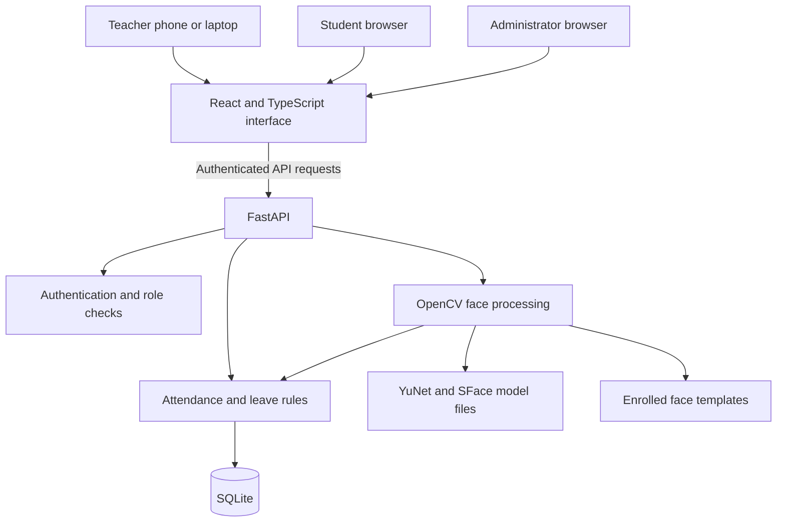

# ClassLens architecture

**Made by Harshad Madhav Dhuppe — Electronics & Computer Engineering, Batch of 2027.**

ClassLens separates the browser interface, API rules, persistent academic data, and face processing. The local application uses one API process and SQLite so the complete workflow can run on a development machine.

## Components

During local development Vite serves the frontend and proxies `/api` to FastAPI. Browser camera capture requires user permission and a secure context. Camera frames are ordinary untrusted uploads when they reach the API.

## Data boundaries

| Concept | Responsibility |
| --- | --- |
| User | Authentication identity and role |
| Student | Academic profile associated with a user where applicable |
| Subject | Class roster and authorized teaching assignment |
| Session | A particular lecture for a subject |
| Attendance | One student's status in a session |
| Leave request | Date range, reason, review state, and reviewer |
| Activity | Traceable changes to important workflow records |
| Enrollment | Student face references used for recognition |

Attendance must be unique per student and lecture. Recognition of the same face in another frame must not create an additional attendance row. Corrections should change the record and write the reason in the same transaction.

## Authorization

The server makes access decisions from the authenticated identity, rather than accepting a role sent by the interface.

- Students read personal records and submit personal requests.
- Subject teachers operate on their assigned classes and sessions.
- A class teacher can review leave for the class assigned by an administrator.
- Administrators manage assignments and permitted administrative operations.

An API endpoint must check both the action and the target record. A valid teacher login alone does not grant access to every class.

## Recognition flow

1. Authenticate the teacher and authorize the session.
2. Validate and decode the uploaded image.
3. Detect individual faces using YuNet.
4. Align each face and generate its SFace embedding.
5. Compare against enrolled candidates from the session's roster.
6. Apply the configured match threshold and ambiguity checks.
7. Record accepted identities without duplicating attendance.
8. Return detected face locations and outcomes for teacher review.

Unavailable model files or absent enrollments must produce a clear unavailable or unknown result. The application must never fabricate identities to make a camera demonstration appear successful.

A candidate similarity score is not a calibrated confidence probability. Threshold selection needs evaluation using representative, consented data separate from enrollment samples. False identity matches and missed matches have different consequences and should be reported separately.

## Leave and attendance

A leave request is a decision workflow, not an attendance observation. Approval does not mark a student present. When a session finishes, unmarked students whose approved leave covers that date receive an excused status. Other unmarked students become absent, and existing attendance records are preserved.

The current percentage calculation includes excused records in its denominator but does not count them as attended. Excused days preserve the personal attendance streak. The application reports this policy; institutional variants and partial day leave are future work.

Completed sessions are locked. Administrators can reopen them before a teacher makes a reasoned correction. Historical sessions do not change merely because leave is approved later.

Leave documents, if introduced, require separate private storage and access rules. They should not become public static assets.

## Operational scope

The initial local architecture favors a reproducible development environment. SQLite provides persistence without a separately managed database service. This does not establish support for multi instance API deployment, high recognition throughput, or reliable distributed jobs.

As workload grows, the next architecture changes would be driven by measurement:

1. Profile image processing latency and database contention.
2. Move expensive recognition into bounded background jobs.
3. Introduce PostgreSQL when concurrency or hosting requirements justify it.
4. Add cross device events with authenticated subscriptions and reconnect recovery.
5. Implement scheduled retention, backups, and monitored failure handling.

These are extensions, not assumed components of the current deployment.

## Validation strategy

Workflow tests should cover authorization, invalid state changes, duplicate recognition, reasoned corrections, and leave decisions. Frontend builds check compilation. A browser smoke test should verify navigation, responsive layout, and representative form submissions.

Recognition requires a separate evaluation with lighting, distance, occlusion, and image quality variation. Report the hardware, model version, thresholds, dataset composition, false matches, misses, coverage, and latency with the results.

## Trust and privacy

- Browser requests and image uploads are untrusted input.
- The database and biometric templates are private application state.
- Signing secrets belong outside source control.
- Public demonstration credentials must not be used for institutional deployment.
- Audit records should explain changes without copying passwords or biometric payloads into logs.
- A manual attendance and correction route remains available when recognition fails.

Before a real institutional pilot, conduct a security review and establish consent, deletion, retention, incident handling, and student appeal procedures.
